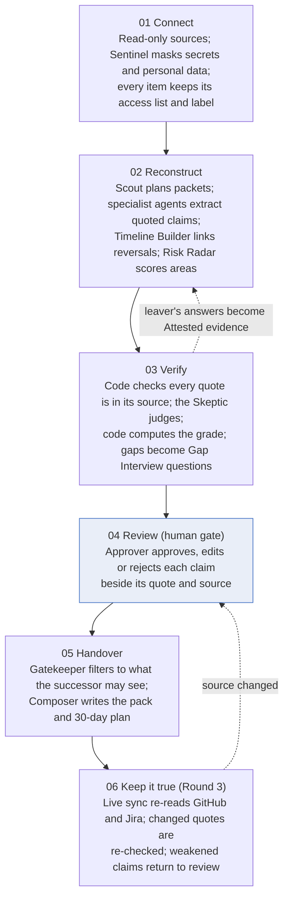
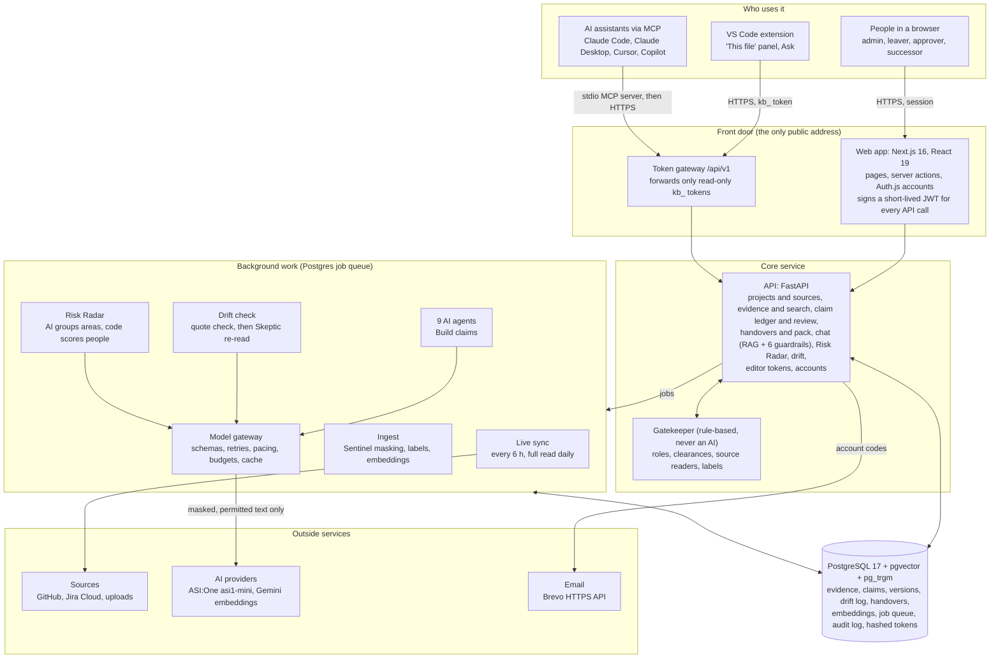
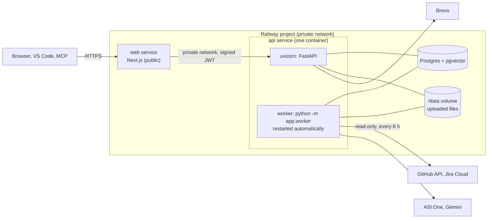
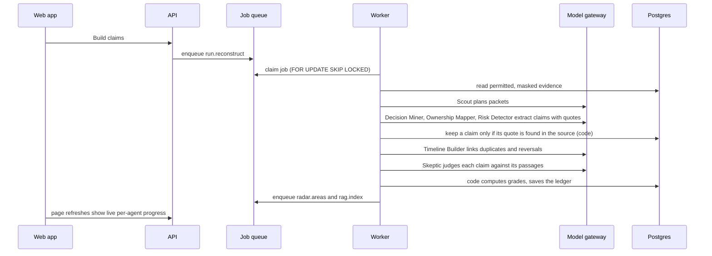
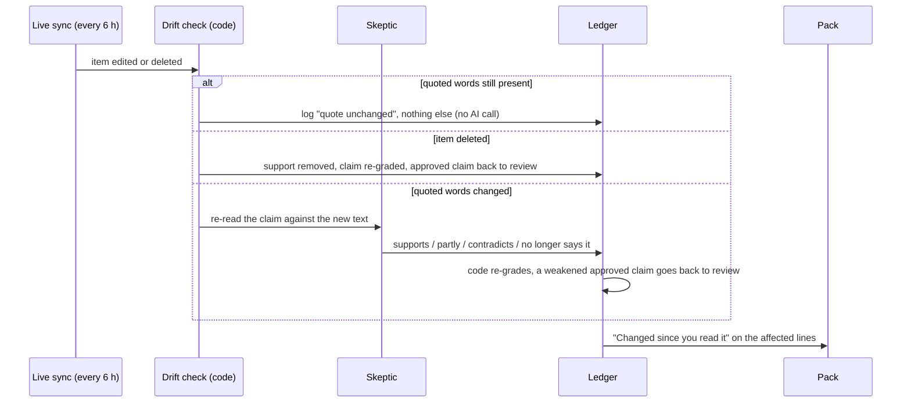
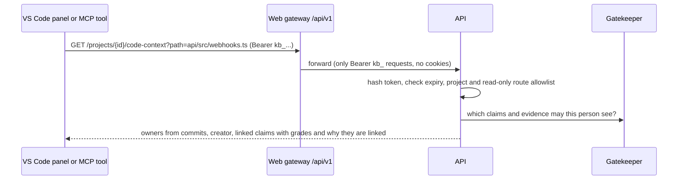

# KnowBridge

**Evidence-linked, permission-aware project handovers that stay true after the handover.**

When someone leaves a project, the reasons behind decisions, the unfinished work and the knowledge of who to
ask usually leave with them. KnowBridge rebuilds the state of a project from the tools the team already uses,
ties every line of the handover to the exact words it came from, and only asks the person who is leaving about
what the evidence can't answer. It also finds knowledge held by just one person before anyone leaves, keeps the
handover up to date when its sources change, and brings it into VS Code and AI coding assistants.

| | |
|---|---|
| **Live product** | https://web-production-ea4e6b.up.railway.app |
| **Walkthrough video** | 11 minutes, 18 chapters, English captions: "Watch the video" on the landing page |
| **Problem statement** | Prevent Critical Knowledge From Leaving With People |
| **Team** | Tanujkeshattiwar |

### Try it in two minutes

1. Open the live product and either **create an account** (a 6-digit code is emailed to you) or **sign in as a
   demo person**: Kabir (admin), Priya (approver), Aarav (leaving) or Meera (taking over).
2. Click **Load the demo** to create *Project Nimbus*, a synthetic college-fest app with 7 sources and 187
   evidence items.
3. Open the **Claim ledger**, the **Risk radar**, a **Handover** and its pack, and the **Chat**. In demo mode an
   admin can open any evidence item and click **Simulate a source change** to watch drift detection work.

---

## Contents

- [Features](#features)
- [How it works](#how-it-works)
- [Architecture](#architecture)
- [The 9 AI agents](#the-9-ai-agents)
- [Round 3: the three improvements](#round-3-the-three-improvements)
- [Trust, permissions, privacy and security](#trust-permissions-privacy-and-security)
- [Technology](#technology)
- [Repository layout](#repository-layout)
- [Run it locally](#run-it-locally)
- [Configuration](#configuration)
- [Deploying to Railway](#deploying-to-railway)
- [Testing and evaluation](#testing-and-evaluation)
- [Known limitations](#known-limitations)
- [Roadmap](#roadmap)
- [Disclosures](#disclosures)

---

## Features

1. **Claim Ledger**: every claim backed by exact quotes, verified by code, with six grades (Verified, Supported,
   Attested, Inferred, Conflicting, Missing) computed by code
2. **9 AI agents** (Scout, Decision Miner, Ownership & Dependency Mapper, Risk & Blocker Detector, Timeline
   Builder, Skeptic, Gap Interviewer, Composer, Sentinel review) as resumable background jobs
3. **VS Code extension** (.vsix): owners, creator, linked decisions and risks for the open file, plus *Ask about this file*
4. **Project chat (RAG)**: answers only from project evidence, with numbered clickable sources; file-aware
5. **Knowledge Risk Radar**: knowledge map, "if they left tomorrow", ranked single points of failure
6. **Capture knowledge**: one-click pre-emptive Gap Interview with the only person who knows an area
7. **Live sync**: automatic GitHub and Jira re-sync (every 6 hours, daily full read)
8. **Drift detection**: quote check, Skeptic re-check, re-grade, back to review when a source changes
9. **"Changed since you read it"** on pack lines, with a before/now comparison and a drift log
10. **MCP server**: 5 tools for Claude Code, Claude Desktop, Cursor and Copilot agent mode
11. **Gap Interview**: AI questions on gaps and contradictions; the leaver's answers re-grade the ledger
12. **Handover Pack**: versioned, approved claims only, 30-day plan, acknowledgements, flags, Markdown and calendar export
13. **Sentinel**: masks secrets and personal data (Aadhaar, PAN, UPI, Indian phone numbers) before storage
14. **Permission-aware access**: sensitivity labels, per-source readers, approved-only for successors, the same rules in web, extension and MCP
15. **Prompt-injection guardrails**: six layers, 85 live attack probes, no leaks
16. **Human review**: approve, edit, reject, bulk approve
17. **Sources**: GitHub (live or snapshot), Jira Cloud (live), documents, Trello/CSV boards, WhatsApp/Discord chats, meeting transcripts
18. **Hybrid evidence search**: keywords plus meaning (pgvector)
19. **Personal access tokens**: read-only, one project, revocable
20. **Accounts**: email sign-up with a 6-digit email code, password reset, account lockout
21. **Demo mode**: four demo personas, one-click demo project, "Simulate a source change"
22. **Projects** with roles (admin, approver, leaver, successor, viewer) and clearances
23. **Dashboard** with handover progress and next steps
24. **Audit log** of every action
25. **Landing page** with an 11-minute walkthrough video (18 chapters, captions), light and dark mode

---

## How it works

The handover is not a document written from memory. It is a **list of claims**, each with a type (Decision,
Owner, Dependency, Risk, Blocker, Open question, Next action, Contact, Recurring problem), the exact quote it
rests on, its sources, and a grade. Nothing reaches the person taking over until an approver has approved it.



### How grades are decided (in code)

| Grade | Rule |
|---|---|
| **Verified** | Two or more independent sources or people support it, or one source plus the leaver's confirmation, or it was read straight from a system |
| **Supported** | One source states it directly |
| **Attested** | Only the leaver confirmed it, in the Gap Interview |
| **Inferred** | Its passages back only part of it, it says more than they do, or its source changed and no longer backs it |
| **Conflicting** | Sources disagree, or the leaver or a changed source contradicts it |
| **Missing** | Asked in the evidence, but nobody answered |

The model only judges each passage (supports / partly / contradicts / unrelated); the grade is computed by code
from those judgements, so the same evidence always gets the same grade. A claim whose quote is not found word
for word in its source is dropped. An approved claim is never silently removed: after a source change it goes
back to a person.

---

## Architecture

### High-level architecture



Reading it from top to bottom: people use the website, developers use the VS Code extension, and AI assistants
use the MCP server. Everything enters through the web app; editor and assistant traffic uses the token gateway,
which accepts only read-only personal access tokens. The API checks who is calling and asks the Gatekeeper
before doing any work. Long work runs in the worker. One PostgreSQL database holds everything. Only masked text
that the reader is permitted to see ever reaches an AI provider, and confidential items never do.

### Deployment on Railway



`deploy/railway/start.sh` runs `alembic upgrade head`, starts the worker in a restart loop, and serves the API.
Migrations therefore run automatically on every deploy.

### "Build claims": what the agents do



### Drift detection: when a source changes



### The editor path: VS Code and MCP



---

## The 9 AI agents

| Agent | What it does | Safeguard |
|---|---|---|
| 1. Scout | Plans which evidence packets (a thread, a chat day, a meeting) each specialist reads | Never drops a packet; if the model fails, every packet goes to every specialist |
| 2. Sentinel | Rules mask secrets and personal data and label each item; an AI review flags sensitive context | The review can only make a label stricter; secret values are never stored |
| 3. Decision Miner | Finds decisions, their reasons and rejected alternatives | Its quote must appear word for word in the cited item |
| 4. Ownership and Dependency Mapper | Who owns which module or task, and what depends on what | Ownership comes from git history and assignees |
| 5. Risk and Blocker Detector | Stale work, recurring bugs, expiring domains and keys, unanswered requests | Each risk names the evidence that triggered it |
| 6. Timeline Builder | Merges duplicates, orders events, links reversed decisions as "replaced" | Code checks each pair shares a subject and goes forward in time |
| 7. Skeptic | Judges each claim against its passages; re-judges claims whose source changed | Never sees how the claim was extracted; code computes the grade |
| 8. Gap Interviewer | Turns gaps and conflicts into questions for the leaver; writes knowledge-capture questions | Answers are dated, attributed evidence and re-grade the ledger |
| 9. Composer | Writes the Handover Pack and the 30-day plan | Uses only approved claims the reader may see; every line cites a claim |

Agents run as resumable jobs, not inside an agent framework. Each agent's instructions live in a versioned skill
file in [`services/api/app/skills/`](services/api/app/skills). Outputs are JSON validated against Pydantic
schemas; invalid output is retried, then dropped. An answer cache makes re-running over unchanged evidence free.

---

## Round 3: the three improvements

### 1. Knowledge Risk Radar — delivered

The **Risk radar** tab scores every area of a project (features, systems and outside services such as Razorpay
or AWS S3) by how concentrated its knowledge is in one person.

- **Four weighted signals:** ownership claims (weight 3), ticket assignees (2), commit authors (1), and who
  explains the topic in chat (1). A person's names are matched across tools (`aarav-m` = `Aarav` = `Aarav Mehta`).
- **AI groups, code scores:** the model only groups claims into areas (with a merge pass for near-duplicates, and
  every area name checked against the claims); shares and risk levels are calculated in code, so results repeat.
- **What you see:** a knowledge map with each person's share, "If they left tomorrow" for each person, and
  ranked risks marked high or medium with "no backup owner".
- **Capture knowledge:** one click starts a pre-emptive interview with that person (what breaks, what it depends
  on, who could take over); the answers become Attested claims.

Code: [`app/radar.py`](services/api/app/radar.py), [`routers/radar.py`](services/api/app/routers/radar.py).

### 2. Live sync with drift detection — partly delivered

- **Live sync:** the worker re-reads live GitHub and Jira sources every `LIVE_SYNC_HOURS` (default 6), and does
  a full read every `FULL_SYNC_HOURS` (default 24) to notice deletions. Uploaded sources are checked again when
  files are re-uploaded.
- **Drift detection:** for each claim citing a changed item, code checks whether the quoted words survived; only
  real changes reach the Skeptic; grades are recomputed; an approved claim whose support weakened returns to the
  approver. Every event is kept in a drift log with the passage before and after.
- **Where you see it:** a "Source changed" filter and before/now comparison in the ledger, a change log on the
  Sources page, an alert on the handover, and "Changed since you read it" in the published pack.
- **Demo mode:** "Simulate a source change" on any evidence item runs exactly what a sync runs.
- **Not delivered:** the Slack and Google Drive connectors, and building connectors as MCP servers. Both
  connectors need an app registered and approved by Slack and Google, which we could not complete in time. They
  are first on the roadmap.

Code: [`app/drift.py`](services/api/app/drift.py), [`app/livesync.py`](services/api/app/livesync.py).

### 3. VS Code extension and MCP server — delivered

- **Personal access tokens:** project → **Editor** → *Make a token*. Read-only, one project, an allowlist of read
  routes, stored only as a SHA-256 hash, 90 days, revocable.
- **VS Code extension** ([`integrations/vscode`](integrations/vscode)): a "This file" panel with who changed the
  file and their share, who created it (earliest commit), the linked owners, decisions and risks with grades,
  sources and the reason they are linked, and an Ask box that answers about the open file.
- **MCP server** ([`integrations/mcp`](integrations/mcp)): five tools, `project_info`, `search_project`,
  `ask_project`, `file_context` and `get_claim`, for Claude Code, Claude Desktop, Cursor and Copilot agent mode.
- **Same rules everywhere:** both reach the API through the website's `/api/v1` gateway, so successors see
  approved claims only, restricted items stay hidden, and the chat guardrails apply.

Downloads are on every project's **Editor** tab. Setup and build steps are in
[`integrations/README.md`](integrations/README.md). For example, with Claude Code:

```bash
claude mcp add knowbridge -e KNOWBRIDGE_URL=https://web-production-ea4e6b.up.railway.app \
  -e KNOWBRIDGE_TOKEN=kb_... -- node /path/to/knowbridge-mcp.mjs
```

---

## Trust, permissions, privacy and security

**Permissions follow the evidence.** Roles are Admin, Approver, Leaver, Successor and Viewer, with clearances for
restricted and confidential items. A source can be limited to named people, and its items carry a sensitivity
label (team, restricted, confidential). A reader sees a claim only if they may see *every* item it cites;
successors only reach approved claims, in the pack, the chat, VS Code and MCP. Hidden items appear as
"withheld" notes, never as silent gaps. The Gatekeeper is rule-based (OpenFGA locally, the same rules in app
code on Railway), so no prompt can get around it.

**Privacy.** Sentinel's deterministic rules mask secrets and personal data (including Indian phone numbers,
Aadhaar, PAN, UPI and IFSC) before anything is stored or sent to an AI. Connectors get read-only access, and
connector tokens are encrypted with `SECRETS_KEY`. Confidential items are never sent to an external model.

**Prompt-injection guardrails (six layers).** Clean (hidden Unicode removed), fence (source text wrapped, fake
tags neutralised), screen (planted instructions in English, Hindi, Hinglish, base64 or look-alike letters cut
before the model reads them), signed chat history (forged turns rejected), answer checks (links, images,
secrets and invented citations removed), and rate limits.

**Accounts.** Passwords are stored as scrypt hashes. Email codes are 6 digits, stored as keyed hashes, valid 10
minutes, one use, and retired after 5 wrong tries. Five wrong passwords lock an account for 15 minutes. Sign-up
and "forgot password" never reveal whether an address has an account. The account routes accept only requests
signed by the website's server.

**Audit.** Every view, approval, export, sign-off, token use and guardrail event is recorded.

---

## Technology

| Layer | Choice |
|---|---|
| Web | Next.js 16 (App Router, React 19, server actions), Tailwind v4, Radix, Auth.js |
| API | FastAPI, SQLAlchemy 2, Alembic, Python 3.12 |
| Database | PostgreSQL 17 with pgvector (HNSW) and pg_trgm: data, vectors and the job queue in one store |
| Background work | A Postgres-backed worker (`SELECT ... FOR UPDATE SKIP LOCKED`) |
| Agents and chat | ASI:One `asi1-mini` through our own model gateway (any OpenAI-compatible API works) |
| Embeddings | Gemini `gemini-embedding-001` (768 dimensions), or a local model |
| Permissions | OpenFGA locally; the same rules in app code on the hosted product |
| Editor | VS Code extension (TypeScript, esbuild, vsce); MCP server (official MCP TypeScript SDK, zod, stdio) |
| Email | Brevo HTTPS API, or any SMTP server |
| Hosting | Railway: a web service, an API + worker service, Postgres with pgvector |

---

## Repository layout

| Path | What |
|---|---|
| `apps/web` | Next.js app: landing page, sign-in and accounts, projects, sources, evidence, ledger, Risk Radar, handovers, pack, chat, editor tokens, audit log. Calls the API server-side; `src/app/api/v1` is the token gateway |
| `services/api/app` | FastAPI app |
| `services/api/app/agents` | The agent pipeline: Scout, extractors, Timeline Builder, Skeptic, Gap Interviewer, Composer |
| `services/api/app/skills` | Versioned instructions for each agent |
| `services/api/app/connectors` | GitHub, Jira, documents, task boards, chats, meeting transcripts |
| `services/api/app/sentinel` | Masking and labelling rules |
| `services/api/app/gatekeeper` | Permission rules (and OpenFGA client) |
| `services/api/app/llm` | Model gateway: providers, pacing, retries, budgets, cache |
| `services/api/app/routers` | HTTP routes: projects, sources, evidence, ledger, handovers, rag, radar, drift, editor, accounts |
| `services/api/app/drift.py`, `livesync.py`, `radar.py` | Round 3: drift detection, the sync schedule, the Risk Radar |
| `services/api/alembic` | Database migrations |
| `services/api/tests` | Automated tests (pytest), including the offline red-team cases |
| `services/api/redteam` | Red-team cases and the live probe runner |
| `integrations/vscode` | VS Code extension |
| `integrations/mcp` | MCP server |
| `integrations/shared` | KnowBridge client shared by the extension and the MCP server |
| `data/nimbus` | Synthetic demo project and its answer key (`answer_key.yaml`) |
| `infra` | OpenFGA model, Postgres init |
| `deploy/railway` | Railway Dockerfile and start script |
| `docs` | Build plan and deployment notes |

---

## Run it locally

You need Docker Desktop, Node 22+ and Python 3.12+.

```bash
cp .env.example .env          # then set at least API_JWT_SECRET, AUTH_SECRET, SECRETS_KEY and an AI key
```

### Everything in Docker

```bash
docker compose up --build
```

Open http://localhost:3000 and pick a Project Nimbus persona.

### For development (hot reload)

```bash
# 1. databases
docker compose up -d postgres openfga

# 2. API  (http://localhost:8000/docs)
cd services/api
python -m venv .venv
.venv/Scripts/pip install -e ".[dev]"        # macOS/Linux: .venv/bin/pip
.venv/Scripts/alembic upgrade head
.venv/Scripts/uvicorn app.main:app --reload --port 8000

# 3. worker (reads sources, runs the agents, live sync and drift checks)
cd services/api
.venv/Scripts/python -m app.worker

# 4. web  (http://localhost:3000)
cd apps/web
npm install
npm run dev
```

On Windows, especially inside a OneDrive folder, `uvicorn --reload` can hang on its first reload. If API
changes don't show up, stop it and start it again (or drop `--reload`). The worker never reloads by itself:
restart it after changing backend code.

### Demo data

Sign in as any persona and press **Load the Project Nimbus demo**, or from the command line (no worker needed):

```bash
cd services/api
.venv/Scripts/python -m app.seed nimbus --reset
```

Project Nimbus is a synthetic college-fest app (`data/nimbus`): a repository snapshot, meeting notes, a Trello
board, and Discord and WhatsApp exports (partly Hinglish), with planted secrets, contradictions and confidential
notes. `data/nimbus/answer_key.yaml` lists everything planted.

### Smart search

Search combines keywords with meaning ("login problems" finds "OTP session lost"). By default meaning search uses
**Gemini embeddings** (`EMBEDDING_PROVIDER=gemini`, needs `GEMINI_API_KEY`). Gemini's free tier allows 100
embeddings a minute, so a big project is indexed in portions over a few minutes; keyword search works straight
away. To keep everything on your own server instead (needs about 1.5 GB RAM): `pip install -e ".[local-search]"`
and set `EMBEDDING_PROVIDER=local`. Set `EMBEDDING_PROVIDER=off` for keyword-only search.

```bash
cd services/api
.venv/Scripts/python -m app.reindex            # index everything already stored
```

### Connecting GitHub

Sources → Connect a source → GitHub. Enter `owner/repo` and a
[fine-grained token](https://github.com/settings/personal-access-tokens/new) limited to that repository with
**read-only** Contents, Issues, Pull requests, Metadata and Actions. Public repositories work without a token
(GitHub then allows only 60 API calls an hour). Commit history is read with `git`, so it costs no API calls; the
server needs `git` installed (the Docker image has it).

### Connecting Jira

Sources → Connect a source → Task board → **Connect Jira Cloud**. Enter the site (`yourteam.atlassian.net`),
your Atlassian email, an [API token](https://id.atlassian.com/manage-profile/security/api-tokens), and a project
key (`ROV`) or any JQL. The connection is checked before anything is saved, and the token is encrypted.

If ports 5432 or 8080 are already in use, set `POSTGRES_PORT` / `OPENFGA_PORT` in `.env` and update
`DATABASE_URL` / `OPENFGA_API_URL` to match.

---

## Configuration

All settings live in `.env` (see [`.env.example`](.env.example)); the web app reads the same file in development.

| Variable | Needed | What it does |
|---|---|---|
| `DATABASE_URL` | Yes | PostgreSQL connection string |
| `API_JWT_SECRET` | Yes | Shared by web and API: signs the per-request user tokens and the website's account requests |
| `AUTH_SECRET` | Yes (web) | Auth.js session secret |
| `SECRETS_KEY` | Yes | Fernet key that encrypts connector tokens |
| `GEMINI_API_KEY` | One AI option | Gemini for agents and embeddings (`GEMINI_API_KEY_BACKUP` for failover) |
| `LLM_PROVIDER`, `LLM_BASE_URL`, `LLM_API_KEY`, `LLM_MODEL_REASONING`, `LLM_MODEL_FAST` | Other AI option | Any OpenAI-compatible model for the agents and chat (we use ASI:One) |
| `API_URL` | Web | Where the web app reaches the API |
| `WEB_URL` | Recommended | The website's address, used in links shown by the extension, MCP and emails |
| `DEMO_MODE` | Optional | `true` enables the demo personas, "Load the demo" and "Simulate a source change" (on both services) |
| `PASSWORD_AUTH` | Optional | Email-and-password accounts (default `true`) |
| `APP_NAME` | Optional | Name in account emails (default `KnowBridge`) |
| `BREVO_API_KEY`, `MAIL_FROM` | For live email | Send account codes through Brevo's HTTPS API (needed where SMTP is blocked, e.g. Railway) |
| `SMTP_HOST`, `SMTP_PORT`, `SMTP_USER`, `SMTP_PASSWORD`, `SMTP_SSL` | Alternative email | Send account codes over SMTP. With no email set up, codes are written to the API log |
| `LIVE_SYNC_HOURS`, `FULL_SYNC_HOURS` | Optional | Live sync interval (default 6) and full re-read interval (default 24); `0` turns the schedule off |
| `TOKEN_DAYS` | Optional | Lifetime of editor access tokens (default 90) |
| `EMBEDDING_PROVIDER` | Optional | `gemini`, `local` or `off` |
| `GITHUB_TOKEN` | Optional | Raises GitHub's rate limit for public repositories |
| `LLM_PARALLEL`, `RUN_MAX_LLM_CALLS`, `RUN_MAX_TOKENS` | Optional | Concurrency and per-run budgets for the agents |
| `DEV_LOGIN` | Local only | "Sign in as any email" for testing; refused in production builds |

---

## Deploying to Railway

The live product runs on Railway with three parts:

1. **web** service, built from `apps/web` (the only public address). Needs `API_URL` (the API's private
   address), `API_JWT_SECRET`, `AUTH_SECRET`, `AUTH_TRUST_HOST=true` and `DEMO_MODE`.
2. **api** service, built from `deploy/railway/api.Dockerfile` at the repository root. It runs migrations, the
   API and the worker (see `deploy/railway/start.sh`), with a volume at `/data` for uploaded files. Needs the
   database, secrets, AI and email settings above, plus `WEB_URL`.
3. **Postgres** with the pgvector extension.

Railway blocks outbound SMTP on its Hobby plan, so set `BREVO_API_KEY` for account emails there.

---

## Testing and evaluation

```bash
cd services/api && .venv/Scripts/python -m pytest          # uses a separate knowbridge_test database
cd apps/web && npm run typecheck && npm run lint
cd integrations/mcp && npm run check
```

| Suite | Size | Result |
|---|---|---|
| Backend tests (pytest, against a real PostgreSQL) | 425 | All pass |
| Of which: offline red-team cases | 88 | All pass |
| Of which: guardrail unit tests | 50 | All pass |
| Search-quality tests (need a local embedding model) | 12 | Run separately |
| Live prompt-injection probes (`redteam/live.py`, last run in Round 2) | 85 | No leaks |

The suite covers connectors, Sentinel, permissions, the claim pipeline and grading rules, the Gap Interview,
the pack, chat guardrails, and the Round 3 features: Risk Radar (10 tests), drift detection and live sync
(16), access tokens and the editor API (14), and accounts and email (21).

### Agent accuracy

Project Nimbus has a planted answer key. The evaluation harness scores a "Build claims" run against it:

```bash
cd services/api && .venv/Scripts/python -m app.eval <project_id>
```

Results on a fresh run of the demo project:

| Planted item | Found | Target |
|---|---|---|
| Decisions (25) | 25 (100%) | 80% or more ✅ |
| Risks and blockers (10) | 9 (90%) | |
| Ownership facts (15) | 12 (80%) | |
| Dependencies (8) | 6 (75%) | |
| Reversed decisions linked (5) | 2 (40%) | |
| Contradictions (6) | 2 (33%) | at least 5 ❌ |
| Fake secrets in any claim | 0 | 0 ✅ |
| Model claims from confidential items | 0 | 0 ✅ |
| Claims caused by the planted injection | 0 | 0 ✅ |

---

## Known limitations

- Contradiction detection (33%) and linking reversed decisions (40%) are below our targets.
- AI steps take 1 to 4 minutes; when the embedding quota runs out, search falls back to keywords.
- Account emails sent from a free-mail address may land in spam at first.
- Sign-in is limited per account, not yet per IP address.
- Deletions in live sources are noticed by the daily full read, not instantly.
- The VS Code extension is installed from a `.vsix` file, not the Marketplace.
- Slack and Google Drive connectors are not built yet.

## Roadmap

1. **Slack and Google Drive connectors**, to finish live sync (needs a registered Slack app and Google OAuth verification).
2. **Tools for the person taking over**: an access checklist, deadlines and renewals, promises they inherit, and "ask the leaver before they go".
3. **Better accuracy** for contradictions and reversals, measured after every change with the evaluation harness.
4. **GitHub webhooks and a pull-request assistant**, and the extension on the VS Code Marketplace.
5. **A meeting notetaker** invited by email, with transcripts going straight into the ledger.
6. **Company readiness**: Google and Microsoft sign-in, per-IP limits, an organisation-wide Risk Radar, audit export and retention settings.

## Disclosures

All product code was written during the official build windows; the commit history shows it. Claude Code
(Anthropic) was used for planning and writing code, and everything was reviewed and run before being committed.
The demo uses only the synthetic Project Nimbus dataset: all people, companies, numbers and "secrets" in it are
made up. The full list of libraries, APIs, models and their licences is in [DISCLOSURES.md](DISCLOSURES.md).
